<picture>
  <source media="(prefers-color-scheme: dark)" srcset="assets/banner-dark.svg">
  <source media="(prefers-color-scheme: light)" srcset="assets/banner-light.svg">
  
</picture>

<p align="center">
  <a href="https://relayforge-r0l7.onrender.com"></a>
  <a href="https://hostelconnect-o8e6.onrender.com"></a>
  <a href="https://driveradar-mocha.vercel.app"></a>
</p>
<p align="center">
  <a href="https://www.linkedin.com/in/nnikhilc97/"></a>
  <a href="https://leetcode.com/u/nikku-2004"></a>
</p>

```ts
const nikhil = {
  studying:   "CS & IT, MVSR Engineering College (final year)",
  focus:      ["full-stack web", "backend reliability", "applied AI"],
  shipped:    ["RelayForge", "HostelConnect", "DriveRadar"],   // all deployed, all ₹0/month
  building:   "Repository Intelligence (final-year project)",
  lookingFor: "SDE / Full-Stack roles, graduating 2027",
};
```

<picture>
  <source media="(prefers-color-scheme: dark)" srcset="assets/divider-dark.svg">
  <source media="(prefers-color-scheme: light)" srcset="assets/divider-light.svg">
  
</picture>

## 🚀 Flagship projects

<a href="https://github.com/nick10-05/RelayForge">
<picture>
  <source media="(prefers-color-scheme: dark)" srcset="assets/card-relayforge-dark.svg">
  <source media="(prefers-color-scheme: light)" srcset="assets/card-relayforge-light.svg">
  
</picture>
</a>

Webhooks from Stripe, GitHub or Razorpay are fire-and-forget: if your server is down, they're gone. RelayForge sits in between, stores every event before acknowledging it, and delivers it with retries, crash recovery and a dead-letter state.

- **At-least-once delivery engine:** transactional outbox, Postgres as the queue (`FOR UPDATE SKIP LOCKED` + leases), fenced completion, poison-payload protection
- **Security-first:** SSRF-safe outbound client with pinned DNS, Standard Webhooks signing, AES-256-GCM secrets at rest, argon2id, tenant isolation
- **Proven, not claimed:** 555 tests on real PostgreSQL 18 (≈95% server line coverage), a chaos receiver, local k6 load tests (665 req/s peak ingest), and a crash test where the server was killed mid-run and all 38,260 events were still delivered

**[Live demo](https://relayforge-r0l7.onrender.com)** · **[API docs](https://relayforge-r0l7.onrender.com/api/v1/docs)** · **[Design doc](https://github.com/nick10-05/RelayForge/blob/main/docs/design.md)** · **[ADRs](https://github.com/nick10-05/RelayForge/tree/main/docs/adr)**

<br>

<a href="https://github.com/nick10-05/HOSTELCONNECT">
<picture>
  <source media="(prefers-color-scheme: dark)" srcset="assets/card-hostelconnect-dark.svg">
  <source media="(prefers-color-scheme: light)" srcset="assets/card-hostelconnect-light.svg">
  
</picture>
</a>

My hostel ran on a WhatsApp group: complaints got buried, the same issue came back daily, and the owner locked the group. I built HostelConnect to fix that, designed around real hostel workflows.

- **Full product:** owner dashboard, complaints with timelines, notices, fee cycles with UPI QR, post-holiday return polls, CSV import, rejoin requests
- **Production-grade ops:** row-level security, a least-privilege DB role, hourly idempotent jobs, nightly `age`-encrypted backups and a tested restore drill
- **Phone-app feel:** floating tab bar, frosted glass, Aurora and Midnight themes, WCAG AA contrast

**[Live app](https://hostelconnect-o8e6.onrender.com)** · **[Decisions](https://github.com/nick10-05/HOSTELCONNECT/blob/main/docs/decisions.md)** · **[Recovery runbook](https://github.com/nick10-05/HOSTELCONNECT/blob/main/docs/RECOVERY.md)**

<br>

<a href="https://github.com/nick10-05/driveradar">
<picture>
  <source media="(prefers-color-scheme: dark)" srcset="assets/card-driveradar-dark.svg">
  <source media="(prefers-color-scheme: light)" srcset="assets/card-driveradar-light.svg">
  
</picture>
</a>

Placement notices reach my batch from emails, WhatsApp, the portal and Telegram. DriveRadar turns them into one feed, filtered by each student's eligibility, with alerts before every deadline.

- **AI with guardrails:** the LLM only extracts fields; every value needs an evidence quote from the notice, and a human approves every drive
- **Measured, not vibes:** an eval harness reports per-field accuracy, hallucination rate and branch precision/recall against a golden set
- **Reliable on free hosting:** a GitHub Actions cron plus a `UNIQUE` constraint gives exactly-once Telegram reminders, 24 h and 3 h before each deadline

**[Live app](https://driveradar-mocha.vercel.app)** · **[Design doc](https://github.com/nick10-05/driveradar/blob/main/docs/DESIGN.md)**

### 🔭 Also on the radar

| | |
|---|---|
| 🔨 **Repository Intelligence** · *final-year project, in progress* | Point it at a codebase and see its architecture, dependency graph, and the files a change is likely to break *before* you merge it |
| 🎧 **[Sundara Kanda](https://github.com/nick10-05/sundara-sara-sangam)** | Verses with chanted audio, word-by-word meanings and summaries in six languages · React, Supabase |

<picture>
  <source media="(prefers-color-scheme: dark)" srcset="assets/divider-dark.svg">
  <source media="(prefers-color-scheme: light)" srcset="assets/divider-light.svg">
  
</picture>

## 🛠️ Toolbox

<table>
  <tr>
    <td align="right"><b>Languages</b></td>
    <td></td>
  </tr>
  <tr>
    <td align="right"><b>Frontend</b></td>
    <td></td>
  </tr>
  <tr>
    <td align="right"><b>Backend</b></td>
    <td>&nbsp;
      
      
      </td>
  </tr>
  <tr>
    <td align="right"><b>Data</b></td>
    <td>&nbsp;
      
      
      </td>
  </tr>
  <tr>
    <td align="right"><b>Ship &amp; run</b></td>
    <td>&nbsp;
      
      </td>
  </tr>
  <tr>
    <td align="right"><b>Quality</b></td>
    <td>
      
      
      
      </td>
  </tr>
  <tr>
    <td align="right"><b>AI</b></td>
    <td>
      
      </td>
  </tr>
</table>

## 🪐 My year in orbit

<picture>
  <source media="(prefers-color-scheme: dark)" srcset="assets/contrib-dark.svg">
  <source media="(prefers-color-scheme: light)" srcset="assets/contrib-light.svg">
  
</picture>

## 📡 Live from my commits

<picture>
  <source media="(prefers-color-scheme: dark)" srcset="assets/terminal-dark.svg">
  <source media="(prefers-color-scheme: light)" srcset="assets/terminal-light.svg">
  
</picture>

<sub>Every graphic on this page is hand-written SVG, redrawn daily by a <a href=".github/workflows/build-profile.yml">GitHub Action</a> that reads the GitHub API. No third-party stats cards.</sub>

<picture>
  <source media="(prefers-color-scheme: dark)" srcset="assets/divider-dark.svg">
  <source media="(prefers-color-scheme: light)" srcset="assets/divider-light.svg">
  
</picture>

## 🧭 How I build

| Habit | Where you can check it |
|---|---|
| Every change goes through a pull request | HostelConnect's PR history |
| Tests run in CI on every push, against real databases | RelayForge and DriveRadar CI: lint → typecheck → tests on real Postgres → Docker build |
| Security from day one, not bolted on | SSRF guard, CSRF checks, session revocation, encrypted secrets and backups |
| Decisions are written down | RelayForge's ADRs, DriveRadar's DESIGN.md, HostelConnect's decisions.md |
| Design for real constraints | Three deployed apps, ₹0 a month between them |

## 📍 Now

- 🔨 **Building** Repository Intelligence, my final-year project
- 🧠 **Daily:** data structures and algorithms on [LeetCode](https://leetcode.com/u/nikku-2004)
- 🤝 **Open to** SDE / full-stack internships and roles

## 📫 Reach me

<p>
  <a href="https://www.linkedin.com/in/nnikhilc97/"></a>
  <a href="https://leetcode.com/u/nikku-2004"></a>
  <a href="https://github.com/nick10-05?tab=repositories"></a>
</p>

<p align="center"><sub><code>git commit -m "thanks for reading this far"</code></sub></p>
